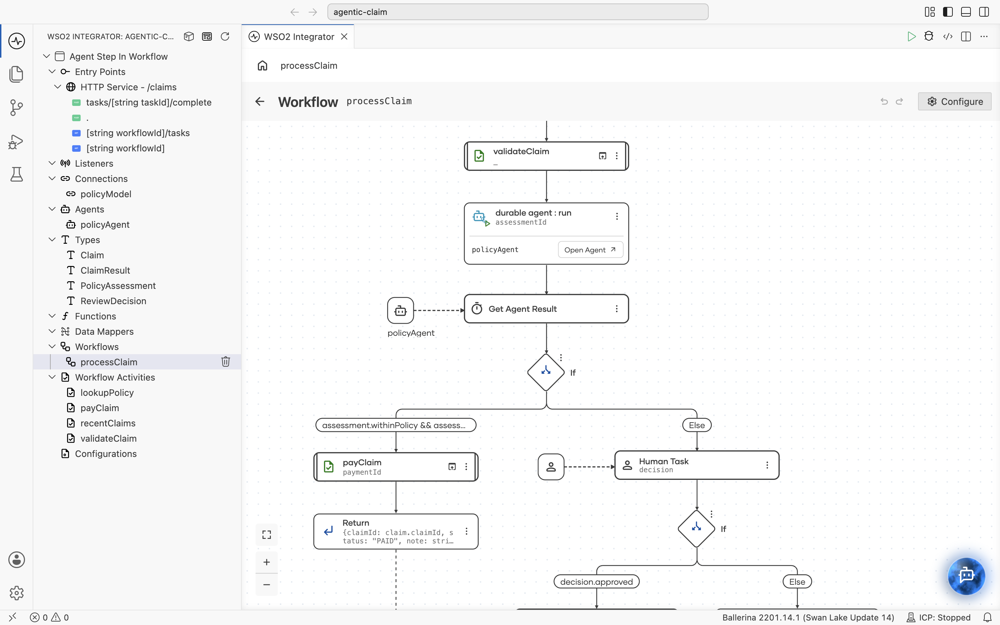
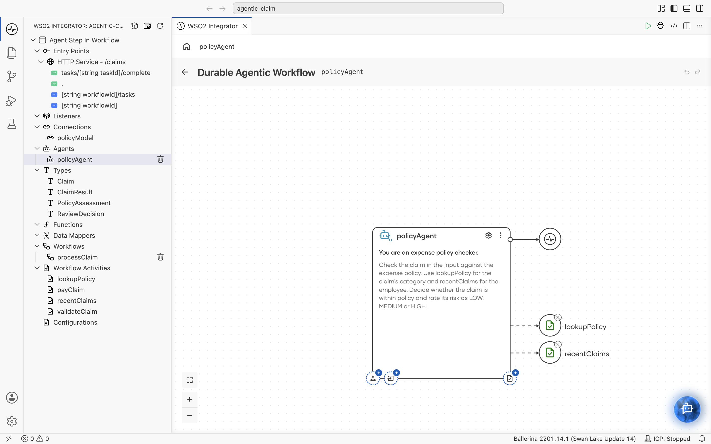
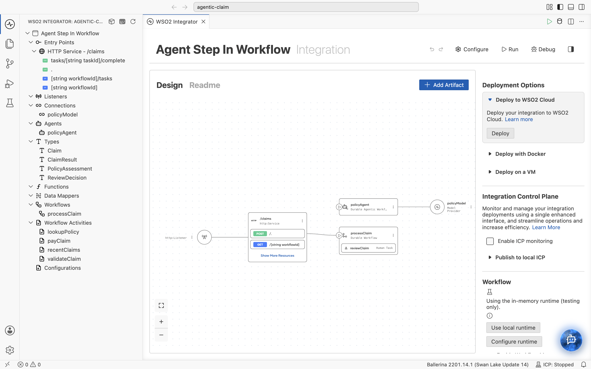

# Agentic workflow: a durable agent as a workflow step

An expense-claim workflow in which one step is an AI agent. The workflow owns the fixed process
(validate, decide, pay); the agent does the judgement (is this claim within policy, how risky is it);
a person reviews only the claims the agent does not clear.



## How it works

```ballerina
@workflow:Workflow
function processClaim(workflow:Context ctx, Claim claim) returns ClaimResult|error {
    string _ = check ctx->callActivity(validateClaim, {"claim": claim});

    string assessmentId = check policyAgent.run("Assess this expense claim.", claim);
    PolicyAssessment assessment = check policyAgent.waitForResult(assessmentId);

    if assessment.withinPolicy && assessment.riskLevel == "LOW" && claim.amount <= AUTO_APPROVE_LIMIT {
        // pay
    } else {
        // finance reviews, with the agent's risk level and reasoning in the task
    }
}
```

- `policyAgent` is a `workflow:DurableAgent` (a Durable Agentic Workflow). Its tools, `lookupPolicy` and
  `recentClaims`, are `@workflow:Activity` functions, and its `resultType` makes it return a typed
  `PolicyAssessment` instead of free text.
- Called inside a workflow, `policyAgent.run(...)` starts the agent as a **child workflow**, and
  `policyAgent.waitForResult(...)` suspends the parent durably until the agent finishes.
- `processClaim` (a Durable Workflow) branches on the typed result: low-risk claims are paid
  automatically, the rest go to a `FINANCE` human task.



### Why not wrap the agent in an activity?

An activity is all or nothing: if it fails part-way, it retries from the start and repeats every
model call and tool call. A durable agent records each model call and each tool call, so after a
crash it resumes where it stopped. It can also wait on people (human tasks, tool approvals) and
shows up as its own child run when you monitor the workflow.

A single model call (classify, extract) is fine inside an activity. Workflow bodies cannot call
models or agents directly; the compiler rejects it.

## Run it

Requirements: WSO2 Integrator (or Ballerina 2201.14.1+), and access to a model provider.

1. Open the folder in WSO2 Integrator and run **Ballerina: Configure Default Model Provider** from the
   Command Palette. It writes the model settings to `Config.toml`.
2. Add the workflow runtime mode to the same `Config.toml`:

   ```toml
   [ballerina.workflow]
   mode = "IN_MEMORY"

   [ballerina.ai.wso2ProviderConfig]
   serviceUrl = "<generated>"
   accessToken = "<generated>"
   ```

   `Config.toml` holds a token, so it is git-ignored. Do not commit it.
3. Start the integration with `bal run` (or **Run** in the designer).

Try a claim:

```bash
# Start a claim; the response carries the workflowId
curl -s -X POST localhost:8090/claims -H 'Content-Type: application/json' \
  -d '{"claimId":"C-1001","employee":"emp-42","category":"meals","amount":480.00,"description":"Team dinner, 6 people"}'

# Read the result (IN_PROGRESS while the agent works or finance has not decided)
curl -s localhost:8090/claims/<workflowId>

# If the agent flagged the claim: list the review task and complete it
curl -s localhost:8090/claims/<workflowId>/tasks
curl -s -X POST localhost:8090/claims/tasks/<taskId>/complete -H 'Content-Type: application/json' \
  -d '{"approved":true,"comment":"Approved: client dinner"}'
```

The `lookupPolicy` and `recentClaims` activities return fixed sample data; replace them with calls
to your policy store and expense system.


